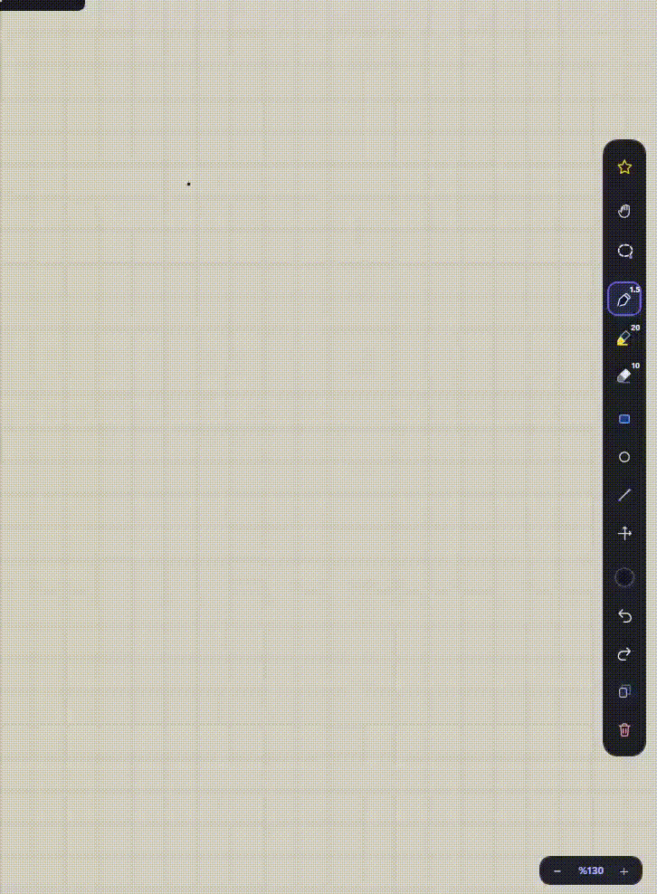

🚀 SarpNote Pro — High-Precision PDF & Stylus Studio
SarpNote, özellikle YKS hazırlık sürecindeki öğrenciler ve yoğun PDF not tutan profesyoneller için C#, WPF ve .NET 8.0 kullanılarak geliştirilmiş, sıfır gecikmeli, yüksek hassasiyetli bir Windows masaüstü PDF görüntüleme ve el yazısı stüdyosudur.

Grafik tabletler (Veikk, Wacom vb.) ve dijital kalemler ile kusursuz uyum sağlayacak şekilde tasarlanmıştır.

✨ Öne Çıkan Özellikler
✒️ 1. Gelişmiş Kalem ve Çizgi Motoru
Pro & Basic Modlar: Basınç hassasiyetli pürüzsüz Pro mürekkep motoru veya sabit kalınlıkta hızlı Basic çizim modu.

Akıllı Geometrik Şekil Tanıma (Hold-to-Shape): Kalemi çizim sonunda kısa bir süre sabit tuttuğunuzda; el yazısı eğrilerinizi otomatik olarak kusursuz düz doğrulara, dairelere, dikdörtgenlere veya üçgenlere dönüştürür.

Mıknatıslı Köşe Yakalama ve Çizgi Birleştirme: Geometrik çizimlerde uçların otomatik olarak birbirine kenetlenmesi ve doğrusal uzantıların tek parça olarak birleştirilmesi.

Hızlı Favori Kalem Slotları: Sık kullanılan renk vekalem kalınlığı kombinasyonlarını tek tıkla seçebilme veya sağ tıkla kaydedebilme.

Özel Renk Paleti (HSV & Hex): Sınırsız renk seçimi, canlı ön izleme ve opaklık (şeffaflık) ayarı.

📄 2. Akıllı Çalışma Alanı ve Kağıt Seçenekleri
Sağ Ekstra Çözüm Kağıdı: Zorlu soru ve test çözümleri için PDF sayfalarının sağ tarafında anında kareli, noktalı veya düz beyaz işlem alanı açabilme.

Özelleştirilebilir Kağıt Renkleri: Klasik Beyaz, Sıcak Krem/Sepya, Not Sarısı, Buz Mavisi, Nane Yeşili ve Gece Koyu olmak üzere 6 farklı kağıt tonu ve uyumlu kılavuz çizgileri.

Göz Koruma Filtreleri: Uzun süreli gece çalışmalarında göz yorgunluğunu önleyen Orijinal Beyaz, Sıcak Sepya ve Loş Gece Modu filtreleri.

⚡ 3. Yüksek Performanslı Render Mimarisi
200Hz V-Sync & Akıcı Akış: Donanım ivmeli render döngüsü sayesinde takılmasız, akıcı kaydırma (Smooth Scrolling) ve dinamik yakınlaştırma (Smooth Zoom).

2-Katmanlı LOD Doku Önbelleği: Arka planda asenkron olarak çalışan Low-Res ve High-Res önbellek mekanizması ile büyük PDF'lerde bile sıfır yükleme gecikmesi.

Düşük RAM Tüketimi: LRU (Least Recently Used) bellek yönetimiyle arka plandaki dokuları dinamik olarak yöneterek sistem kaynaklarını yormaz.

🌐 4. Çoklu Dil Desteği (Localization)
Arayüz dilini ayarlardan anında değiştirebilme: Türkçe, English, Deutsch, Français, Español.

💻 Teknik Altyapı
Framework: .NET 8.0 (WPF / Windows Forms entegre)

PDF Motoru: PdfiumViewer (Google PDFium yerel kütüphane desteğiyle)

Veri Kalıcılığı: JSON tabanlı hafif meta-veri ve .isf formatında sıkıştırılmamış hızlı mürekkep katmanı kayıt sistemi.
